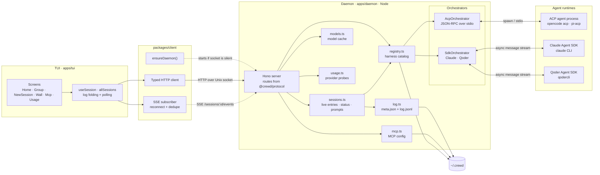
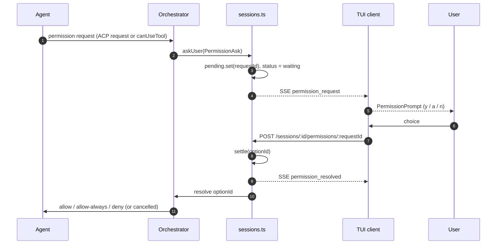

# Architecture

crewd is split into a long-lived daemon that owns agent processes and session state, and a terminal client that renders and controls those sessions. The two communicate over a Unix domain socket using ordinary HTTP plus Server-Sent Events (SSE). Both sides share types and route names from `@crewd/protocol`. An optional Android app (`apps/mobile`) reaches the same routes over HTTPS through a loopback-only listener.

## Design principles

1. **The daemon owns everything that outlives a screen.** Agent processes, session metadata, event logs, permission requests, and MCP configuration live in the daemon. Closing a tile or the TUI does not kill an agent.
2. **One event vocabulary.** Each orchestrator translates its vendor's messages into the same `Ev` union (`text`, `thinking`, `tool`, `turn_end`, `status`, `permission_request`, `mode`, `model`, …). Unknown messages become `raw` so nothing is silently dropped.
3. **Log first, stream second.** Every event is appended to `log.jsonl` before it is broadcast. Clients can reconnect and replay from any sequence number.
4. **Local by default.** The daemon binds a Unix socket with mode `0600` and no authentication layer. Remote access is opt-in: `~/.crewd/remote.json` (`{ "port": n }`, read at startup) adds a second listener bound to `127.0.0.1` only, guarded by one static bearer token in `~/.crewd/remote-token` (mode `0600`). That token plus tailnet membership is the whole trust boundary; the phone sees the same routes, the same error shapes, and the same permissions as the socket.
5. **Thin UI.** The TUI holds only view state and preferences. Session status, modes, models, commands, and permission queues are derived from the daemon's log.

## High-level diagram



ASCII version, for terminals without Mermaid rendering:

```
┌──────────────────────────── Terminal ────────────────────────────┐
│  apps/tui (OpenTUI + React)                                      │
│  Home · Group · NewSession · Wall/Tiles · Mcp · Usage · Help     │
└───────────────────────────────┬──────────────────────────────────┘
                                │ @crewd/client: fetch
                                │ HTTP over Unix socket + SSE
                                ▼
┌──────────────────────── apps/daemon (Node) ──────────────────────┐
│  Hono server ── routes from @crewd/protocol                      │
│      ├── sessions.ts ── live registry, status, prompts, idle stop│
│      ├── registry.ts ── harness catalog + install checks         │
│      ├── models.ts ──── per harness+cwd cache (10 min)           │
│      ├── mcp.ts ─────── ~/.crewd/mcp.json                        │
│      ├── usage.ts ───── provider usage probes                    │
│      └── log.ts ─────── meta.json + log.jsonl (append-only)      │
│                              │                                   │
│                    orchestrators                                 │
│             ┌────────────────┴────────────────┐                  │
│             ▼                                 ▼                  │
│       AcpOrchestrator                 SdkOrchestrator            │
│       (JSON-RPC over stdio)      (Claude / Qoder SDK query)      │
└─────────────┬─────────────────────────────────┬──────────────────┘
              ▼                                 ▼
     ACP agent process                   claude / qodercli
     (opencode acp, pi-acp, …)           through vendor SDKs
```

## Package and process layout

| Path | Responsibility |
| --- | --- |
| `packages/protocol` | Shared contract: `Harness`, `SessionMeta`, `Ev`, `LogLine`, `Usage`, capability and permission types, `routes`, `SOCKET_NAME`. No runtime logic. |
| `packages/shared` | Log and stream helpers with no Node, Bun or React imports: `toBlocks`, `foldState`, `claudeModes`, `sseBlocks`, and the `Item` / `Block` / `ToolItem` types. `main` and `types` point at `src/index.ts`, so Bun, the daemon bundle and Metro can all consume the source. |
| `packages/client` | Typed daemon client: HTTP calls over the socket, SSE subscription with backoff and sequence dedupe, `ensureDaemon()` auto-start. Uses Bun's `unix` fetch, so the phone app speaks plain HTTPS against the same routes instead. |
| `apps/daemon` | Node process, bundled by Bun to `dist/main.js`. Hono server, session manager, orchestrators, log store, MCP and usage modules, optional remote listener. |
| `apps/tui` | Bun-based OpenTUI/React terminal application. Screens, log folding, input, tiles, palettes, preferences. |
| `apps/mobile` | Expo/React Native app, Android only. HTTP + SSE client of the daemon's routes over the remote listener; server address and token live in `expo-secure-store`. |
| `fixtures/claude` | Sample Claude transcript JSONL files. |

At runtime there is one daemon per socket. It is started either by `bun run daemon` or by the TUI's `ensureDaemon()`, which builds `apps/daemon/dist/main.js` if missing, spawns `node dist/main.js` detached, and waits up to about five seconds for `GET /harnesses` to answer. Startup probes the socket with a connect: a connectable socket means another daemon already owns it. The socket is created under `umask 077` and then explicitly `chmod`ed to `0600`.

One React version: `apps/mobile` installs what Expo SDK 58 pins (`react@19.3.0`) and `apps/tui` declares that exact version rather than a range, because two React copies in one workspace break hooks under Metro. `@opentui/react` accepts `>=19.2.0`, so the TUI and the app use the same copy and `apps/mobile` stays inside the root `workspaces` glob; no Metro `watchFolders` fallback was needed.

## Components

### Daemon

| Module | Responsibility |
| --- | --- |
| `src/main.ts` | Socket path validation (macOS 104-byte limit), singleton check, session recovery, optional `127.0.0.1` remote listener, signal handling, graceful shutdown. |
| `src/server.ts` | Hono routes, request validation, the two SSE endpoints (both write a `: ping` comment every 15s), error mapping (`HttpError` → 4xx, everything else → 500). |
| `src/remote.ts` | The remote listener's front: reads `remote.json` for the port, creates and reuses `remote-token` (`0600`), checks `Authorization: Bearer` by SHA-256 + `timingSafeEqual`, and forwards allowed requests to the existing `app` unchanged. Denials log the path only. No CORS, no Host check. |
| `src/awake.ts` | Holds `caffeinate -i -w <daemon pid>` while at least one session is busy, so a turn is not lost to idle sleep. macOS only, and only when remote is enabled. |
| `src/sessions.ts` | In-memory `live` map keyed by crewd session id. Creates entries, writes metadata, appends events, fans out to subscribers, tracks status and open permission requests, enforces a 15-minute idle stop, and recovers interrupted sessions at boot. |
| `src/registry.ts` | Built-in harness catalog plus `~/.crewd/harnesses.json`. Determines installation by checking the binary on `PATH`, maps harness → orchestrator class, and constructs instances. |
| `src/models.ts` | Model-list cache keyed by harness + cwd with a 10-minute TTL; concurrent callers share one probe. Live sessions can refresh the cached list. |
| `src/mcp.ts` | Reads and validates `mcp.json`; selects the servers for a session (named subset or all enabled). |
| `src/usage.ts` | One provider per harness: Claude OAuth usage API, Qoder SDK `getUsageInfo()`, OpenCode `stats` output. Fetched fresh on each request; failures are isolated per harness. |
| `src/log.ts` | The only module that writes session files. Synchronous append/read of `log.jsonl`, read/write of `meta.json`, metadata listing, daemon log. |
| `src/util/async-queue.ts` | Push-based async iterable used for orchestrator output, SDK input, and SSE backlogs. |

### Orchestrators

`Orchestrator` (`src/orchestrators/orchestrator.ts`) is the boundary between the daemon and an agent. One instance exists per running session. It exposes `start`, `send`, `interrupt`, `setMode`, `setModel`, `close`, `events`, and `caps`, plus a callback `askUser` that `sessions.ts` wires to the permission queue. Static helpers `listSessions`, `loadHistory`, and `listModels` allow the daemon to inspect a harness without a running crewd session.

**ACP (`AcpOrchestrator`)** spawns the harness command (`opencode acp`, `pi-acp`, or a user-defined command) and speaks stable ACP v1 over newline-delimited JSON on stdio using `@agentclientprotocol/sdk`. On start it initializes the client (advertising no `fs/*` or `terminal/*` capabilities), then opens a session with `session/new`, `session/resume`, or `session/load` depending on capabilities and whether a native id was supplied. `session/update` notifications map to crewd events; permission requests from the agent map to `askUser`. Modes and models are read from either legacy `modes` state or `configOptions` of category `mode`/`model`, and switched through `session/set_mode` or `session/set_config_option`. Short-lived agent processes back the static helpers (`withAgent`), always killed afterwards.

**SDK (`SdkOrchestrator`)** is shared plumbing for vendor SDKs whose `query()` consumes an async iterable of user messages and yields a message stream. `ClaudeSdkOrchestrator` and `QoderSdkOrchestrator` subclass it, implement `runQuery`, `toEv`, and `readNativeId`, and pull the vendor messages. Claude and Qoder share `claudeMessageToEv` because their message shapes mirror each other. Permission decisions go through `canUseTool`, which maps crewd's `allow` / `always` / `deny` / cancel answers to SDK permission results. Qoder is loaded through a variable module specifier and is optional at runtime; the SDK is externalized from the daemon bundle.

| Harness | Kind | Start | Resume | Modes | Models |
| --- | --- | --- | --- | --- | --- |
| `claude` | SDK | `query()` | `resume: sessionId` | Claude permission modes | `supportedModels()` / `setModel()` |
| `qoder` | SDK | `query()` | `resume: sessionId` | permission mode | `initializationResult().models` / `setModel()` |
| `opencode` | ACP | `session/new` | `session/resume` or `session/load` | ACP modes or config option | ACP config option |
| `pi` | ACP | `session/new` | same as ACP | same as ACP | same as ACP |

## Session model

### Identity

A crewd session has a UUID `id` and an optional harness-owned `nativeId`. `nativeId` is what the harness uses to resume; it is discovered from the agent during `start`/first turn. Crewd's own sessions are stored under `~/.crewd/sessions/<id>/`; sessions found in a harness's store are returned as `source: "native"` and are not written to crewd's log until the user resumes them. When listing sessions per harness, crewd's entries win over native entries with the same `nativeId`.

### Status

| Status | Meaning |
| --- | --- |
| `running` | A turn is in progress. |
| `waiting` | A turn is blocked on an unanswered `permission_request`. |
| `idle` | No turn in progress; the orchestrator may still be alive. |
| `interrupted` | A turn was active when the daemon shut down, or the session was stopped mid-turn. |
| `dead` | The session was deleted, or its agent process exited mid-turn; new messages are rejected with `409`. |

Only `running` and `waiting` count as busy. Orchestrator `status` events can only change a busy session; `interrupted` is set by the daemon on shutdown, and a `dead` session is never revived.

### Lifecycle

1. **Create** — validate harness, installation, and an existing absolute `cwd`; write `meta.json`; if a `resumeId` was given, import the harness history into `log.jsonl` once and derive a title. Then start the orchestrator and begin pumping its event stream.
2. **Send** — append the user line, set `running`, start an orchestrator if the session was stopped, wait for readiness, then hand the prompt to the orchestrator.
3. **Stream** — every orchestrator event is appended with a monotonically increasing `seq` and timestamp, written to `meta.json` when it changes `nativeId`, `permissionMode`, or `model`, then fanned out to subscribers.
4. **Turn end** — `turn_end` clears pending prompts and moves the session to `idle`.
5. **Idle stop** — 15 minutes after the last event, the orchestrator is closed but the session and log remain. The next message restarts it with `nativeId`, resuming the harness conversation.
6. **Recovery** — on daemon start, any session left `running` or `waiting` is set to `interrupted`; permission requests that were open in the log are replayed as cancelled.

## Event and transport flow

### Sending a prompt

```mermaid
sequenceDiagram
  autonumber
  participant U as User (TUI)
  participant C as @crewd/client
  participant D as Daemon
  participant S as sessions.ts
  participant O as Orchestrator
  participant A as Agent
  participant L as log.jsonl

  U->>C: send(text, images)
  C->>D: POST /sessions/:id/messages
  D->>S: send(id, text, images)
  S->>L: append user line
  S->>S: status = running
  S->>O: send(text, images)
  O->>A: prompt
  loop until turn ends
    A-->>O: vendor / ACP message
    O-->>S: Ev (text, thinking, tool, …)
    S->>L: append event line (seq++)
    S-->>D: fan out to subscribers
    D-->>C: SSE event, id = seq
    C-->>U: useSession folds into blocks; Tile renders
  end
  A-->>O: turn complete
  O-->>S: turn_end
  S->>S: status = idle
```

### Permission round-trip

ACP agents call the client's `session/requestPermission`; SDK agents call `canUseTool`. Both end up in `sessions.ask`, which assigns a `requestId`, stores the allowed option ids, emits a `permission_request`, and sets status `waiting`. The TUI shows the prompt; the answer is posted back and resolves the waiting promise. The resolution event is also logged so a client that connects later does not see a stale open prompt.



### SSE replay

`GET /sessions/:id/events` reads the backlog after `Last-Event-ID` (or `?after=`) and subscribes to live lines in the same tick, so no line can fall between replay and subscription. It writes each line as an SSE event whose `id` is the log `seq`. The client reader reconnects with exponential backoff, sends the last seen id, and drops duplicates by sequence number. Native-only sessions have no daemon entry and therefore no live stream; the TUI loads their history once and resumes the session on the first send.

### Log format

```ts
type LogLine = { seq: number; ts: number } & (
  | { kind: 'user'; text: string }
  | { kind: 'event'; ev: Ev }
)
```

`meta.json` stores the `SessionMeta` (id, harness, native id, cwd, title, status, timestamps, source, MCP names, mode, model). Session ids are validated against `/^[\w-]+$/` before being used as path segments. Log appends are synchronous to keep ordering trivial; reads tolerate a torn trailing line left by a crash.

## HTTP API

All routes are defined in `packages/protocol/src/index.ts` and served by `apps/daemon/src/server.ts`. The remote listener serves the same list, so a phone and the TUI see one API and one error shape.

| Method and path | Purpose |
| --- | --- |
| `GET /harnesses` | Harness list with installation state, capabilities, and session counts. |
| `GET /harnesses/:id/sessions?cwd=` | Crewd sessions plus the harness's native sessions, deduped, newest first. |
| `GET /harnesses/:id/models?cwd=&refresh=1` | Model list for a project; cached for 10 minutes unless refreshed. |
| `POST /sessions` | Create (or resume) a session: `{ harness, cwd, resumeId?, mcp?, permissionMode?, model? }`. |
| `GET /sessions` | Crewd's own sessions, live and past, newest first. |
| `GET /projects` | Folders crewd has sessions in, as `{ cwd, lastUsed, harnesses }`, newest first, capped at 50. Deleted and throwaway folders drop out (the same rule the TUI applies client-side), so a phone can choose a `cwd` without browsing the disk. |
| `GET /sessions/:id/history?harness=&turns=N` | Crewd log when the id is ours; otherwise ask one or all harnesses for native history. `turns=N` returns only the last N turns, cut at a user line. |
| `GET /sessions/:id/events` | SSE stream with backlog replay (`Last-Event-ID` / `?after=`). |
| `GET /events` | Global SSE stream of the session list: one `snapshot` event holding every `SessionMeta` on connect, then a `session` event per metadata change. No ids and no replay, so a reconnect just takes a fresh snapshot. |
| `POST /sessions/:id/messages` | Send `{ text, images? }`. Images are absolute paths read and encoded by the daemon. |
| `POST /sessions/:id/permissions/:requestId` | Answer an open prompt with `{ optionId }`. |
| `POST /sessions/:id/mode` | Switch mode with `{ mode }`. |
| `POST /sessions/:id/model` | Switch model with `{ model }`. |
| `POST /sessions/:id/interrupt` | Cancel the current turn and close open prompts. |
| `DELETE /sessions/:id` | Mark the session dead, close its orchestrator, keep its files. |
| `GET /usage` | Fresh usage per enabled harness (`cache-control: no-store`). |
| `GET /mcp` · `PUT /mcp` | Read or replace the MCP server list. |

## Cross-cutting behavior

### Models

Listing models may start an agent process, so `models.ts` caches per harness + cwd with a 10-minute TTL. Concurrent callers share one in-flight probe. Failures are returned as `{ models: [], error }` and are not cached. When a live session reports its own list, `remember()` refreshes the cache without losing the previously probed default. The TUI saves the last picked model per harness in `tui.json` and can pass it at create time; otherwise the harness default applies.

### MCP

`mcp.json` is a validated array of `{ name, command, args?, env?, enabled? }`. A session keeps the names chosen at creation and receives those servers; without a selection it receives every enabled server. Claude and Qoder receive the list through their SDK options (Qoder marks entries as `stdio`); ACP agents receive it in `session/new`, `session/resume`, or `session/load`.

### Usage

Usage is intentionally not cached. Claude reads the local OAuth login (macOS keychain, then `~/.claude/.credentials.json`) and calls Anthropic's usage endpoint, adding a pace headline for the weekly window. Qoder opens a short-lived query and asks for `getUsageInfo()`. OpenCode parses local `opencode stats` tables. A provider failure yields an entry with `error` and does not affect the others.

### Screen state

The TUI keeps only preferences and view state on disk (`tui.json`, `wall.json`) and in React state. Session content is always rebuilt by folding `LogLine[]`: partial text chunks merge, tool start/end pair by id, thinking lines merge, and the latest agent turn is shown in full while older ones collapse. The open-tile wall is restored on launch and filtered against sessions that still exist.

## Extension points

- **Another ACP agent** — add an entry to `~/.crewd/harnesses.json`; no code change is required. The daemon reads the file on every harness lookup.
- **Another SDK agent** — add an orchestrator class, register it in `SDK` and `SDK_BINARY` in `registry.ts`, and add a `BUILTIN` entry. Reuse `SdkOrchestrator` and `claudeMessageToEv` if the vendor SDK mirrors Claude's message shapes.
- **Another usage provider** — add a function to the `providers` map in `usage.ts`.
- **A new daemon route** — add the path to `routes` in `@crewd/protocol`, a handler in `server.ts`, and a typed wrapper in `@crewd/client`.

## Known tradeoffs

- **Synchronous log IO** — chosen so appends are ordered without locks. `log.read` parses the whole file on each call (marked `shortcut:` in the source); offset indexing would be the next step for very large logs.
- **TUI log refolding** — `useSession` folds the full log on every new line (also marked `shortcut:`). This is fine for normal chat-sized sessions.
- **Qoder SDK surface** — its integration was written against documentation and is marked with `shortcut:` comments; the SDK is an optional runtime dependency loaded through a variable specifier.
- **Security model** — the daemon trusts any process that can open the user's socket. Permission bypass mode exists and is gated by a TUI confirmation, but there is no separate authorization layer. Remote access is no stricter: one static bearer token in front of a `127.0.0.1`-only listener, with tailnet membership as the outer boundary, and nothing restricted remotely that the socket already allows — a token holder controls the Mac through its agents. CORS and Host checks stay out by design; a browser page cannot send the bearer header cross-origin without a preflight the daemon never answers.
- **ACP scope** — `fs/*` and `terminal/*` client capabilities are not advertised; ACP `fork` is unstable in v1 and treated as optional.
